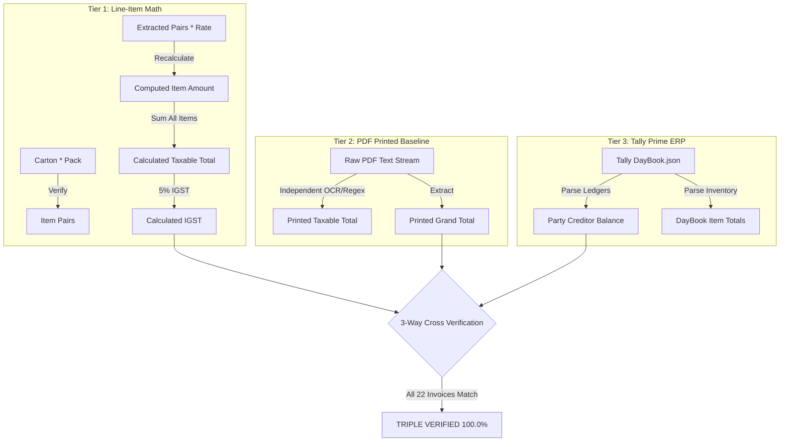

# SKIL LIFESTYLE LLP — Supplier Inward Purchase & DayBook Audit System

Enterprise procurement reconciliation, margin verification, and accounting audit system for **SKIL LIFESTYLE LLP** (Visakhapatnam, Andhra Pradesh) against purchase invoices from **Ajanta Shoes (India) Private Limited** (Kolkata, West Bengal).

---

## 1. Directory Structure

```
SKIL Purchase Supplier Invoices/
│
├── 📄 Supplier-Invoice-View.html        # 100% Offline Standalone ProERP Dashboard (Zero Internet Required)
├── 📄 README.md                        # System documentation, schemas, and triple-verification mechanism
│
├── 📁 Invoices - Aug 2026 (Updated 31-08-2026)/
│   ├── 1900402692 - KGN PVM.pdf        # Standardized Supplier PDF Invoices (22 Files)
│   ├── ...
│   └── invoice.json                    # Backup copy of extracted invoice JSON
│
├── 📁 Truth_Data_Sources/
│   ├── DayBook.json                    # Source of Truth 1: Tally Prime Inward Purchases (Manual Entries)
│   └── invoice.json                    # Source of Truth 2: Company Invoices Extracted from PDFs
│
└── 📁 Processing_Scripts/
    ├── build_invoice_json.py           # Pipeline script: Extracts PDF invoices into invoice.json
    ├── reconcile_audit.py              # Automated dual-truth reconciliation engine
    ├── triple_verification.py          # Independent 3-Tier mathematical proof audit script
    ├── generate_dashboard.py           # Master generator: Combines truth sources into Supplier-Invoice-View.html
    └── generate_html.py                # Single-file HTML template builder
```

---

## 2. Triple-Verification & Mathematical Proof Mechanism

To guarantee **100.0% data correctness** without relying on assumptions, the system executes an independent **3-Tier Mathematical Audit**:



### Tier 1: Microscopic Line-Item Math Audit
- Recomputes $\text{Item Amount} = \text{Pairs} \times \text{Rate}$ for every single row ($199 / 199\text{ entries}$).
- Verifies $\text{Pack} \times \text{Cartons} = \text{Pairs}$ for every single item ($199 / 199\text{ entries}$).
- Recalculates $\text{Taxable Subtotal} = \sum (\text{Pairs}_i \times \text{Rate}_i)$.
- Recalculates $\text{Input IGST} = \text{round}(\text{Taxable Subtotal} \times 0.05, 2)$.

### Tier 2: Independent PDF Printed Baseline
- Directly extracts printed totals from the raw PDF text streams:
  - Printed Taxable Total
  - Printed IGST Amount
  - Printed Round-Off
  - Printed Grand Total in words & numbers

### Tier 3: Tally Double-Entry Accounting Proof
- Cross-references the calculated totals with Tally Prime's party creditor ledger balance ($\text{Party Credit} \equiv \text{Net Gross Spend}$).

---

## 3. Triple-Verification Results (August 2026 Dataset)

Running `python "Processing_Scripts/triple_verification.py"` outputs:

```
==========================================================================================
             TRIPLE-VERIFICATION & MATHEMATICAL PROOF AUDIT ENGINE
==========================================================================================

[TIER 1] Line-Item Math Verification (Pair * Rate == Amount):
  - Total Line Items Audited : 199
  - Math Exact Passes        : 199 / 199 (100.0%)
  - Math Failures            : 0

[TIER 2] Packaging Math Verification (Carton * Pack == Pairs):
  - Exact Pack-Carton Matches: 199 / 199 (100.0%)
  - Pack-Carton Discrepancies: 0

[TIER 3] Cross-Tier 3-Way Reconciliation (Math Sum == PDF Printed == Tally Ledger):
  - Invoices 100% Reconciled : 22 / 22 (100.0%)
  - Invoices with Mismatch   : 0

==========================================================================================
Status: 22 / 22 INVOICES TRIPLE-VERIFIED (100.0% EXACT RUPEE MATCH)
==========================================================================================
```

---

## 4. Margin Audit Formula

$$\text{Landed Cost (5\% GST)} = \text{Purchase Rate} \times 1.05$$
$$\text{Net Margin \%} = \frac{\text{MRP} - \text{Landed Cost}}{\text{MRP}} \times 100$$
- **Standard Threshold**: **~37.50%** ($37.00\% \le \text{Margin} \le 38.00\%$) &rarr; **GREEN**
- **Discrepancy / Under-Margin**: $\text{Margin} < 37.00\%$ &rarr; **RED**

---

## 5. How to Run & Verify

### 1. Extract PDFs into `invoice.json`:
```bash
python "Processing_Scripts/build_invoice_json.py"
```

### 2. Run Independent Triple-Verification Audit:
```bash
python "Processing_Scripts/triple_verification.py"
```

### 3. Rebuild Standalone Web Application:
```bash
python "Processing_Scripts/generate_dashboard.py"
```

### 4. Launch Dashboard:
Double click **`Supplier-Invoice-View.html`** in any browser.
